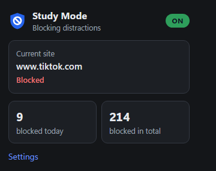
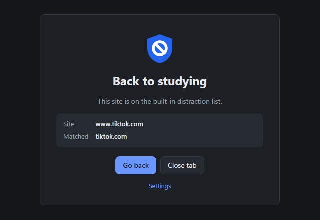
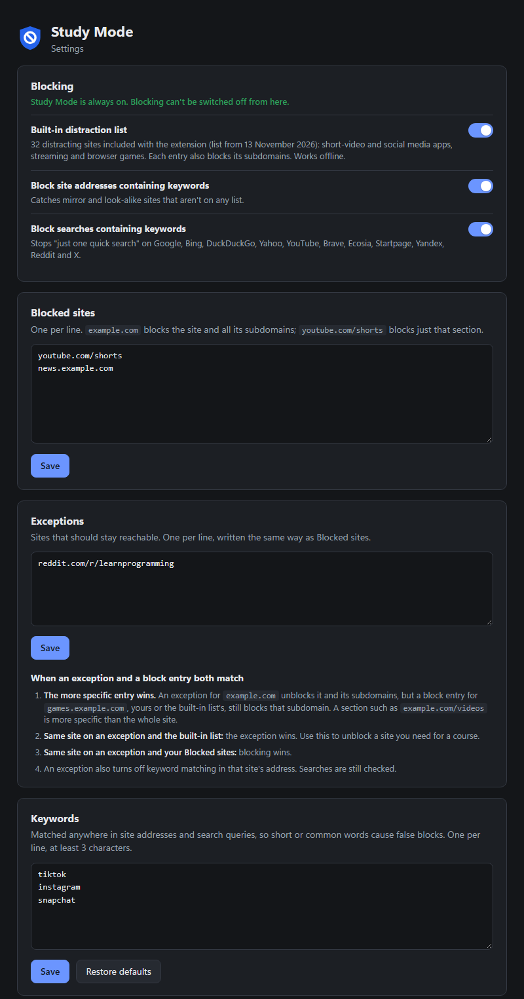

# Study Mode for Firefox


**Study Mode is a Firefox extension that blocks TikTok, Instagram and other distracting websites while you
study.** Open a blocked site and you get a calm "Back to studying" page instead. You can add your own sites,
make exceptions for anything a course needs, and lock the settings with a password so "just five minutes"
doesn't turn into an hour.

| Popup | Blocked page |
|---|---|
|  |  |

<details>
<summary>Settings page</summary>



</details>

*Screenshots show example settings.*

## What it does

- **Built-in distraction list**: short-video and social media sites (TikTok, Instagram, Snapchat, X, Reddit and
  more), streaming sites and browser games. Works offline, with nothing to download.
- **Your own block list**: `example.com` blocks a whole site, and `youtube.com/shorts` blocks just one part of
  a site, so YouTube stays usable for lectures while Shorts is blocked.
- **Exceptions**: unblock anything you need for a course, for example `reddit.com/r/learnprogramming`.
- **Look-alike and search blocking**: addresses and searches containing your keywords (`tiktok`,
  `instagram`, `snapchat` by default) are blocked too.
- **Password lock**: a password is needed to change the settings.
- **Always on**: there's no off switch in the extension. An optional Windows service (below) can keep it
  installed, with a waiting period before it can be turned off.
- **Private**: nothing about your browsing leaves your computer.

## Try it

1. Download `study-mode-1.0.0-unsigned.zip` from the [latest release](https://github.com/REralph/study-mode/releases/latest).
2. In Firefox, open `about:debugging#/runtime/this-firefox`, click **Load Temporary Add-on…** and pick the zip.

Temporary add-ons are removed when Firefox closes. To keep it, sign it for free as an *unlisted* add-on with an
[addons.mozilla.org API key](https://addons.mozilla.org/developers/addon/api/key/):

```bash
npx web-ext sign --source-dir extension --channel unlisted --api-key YOUR_KEY --api-secret YOUR_SECRET
```

and install the signed `.xpi` from `about:addons` → gear icon → **Install Add-on From File…**.

## How it works (for developers)

- **Blocks before any connection is made.** A Manifest V3 `webRequest` listener checks every request. Pages are
  redirected to the blocked page, and images, videos and frames from blocked sites are cancelled. Single-page-app
  navigations (`history.pushState`) are caught through `webNavigation`.
- **A small rule engine** ([`extension/lib/matcher.js`](extension/lib/matcher.js)) normalises whatever people
  paste (URLs, hosts-file lines, `*.domain`, adblock syntax) into domain and path rules. Conflicts are settled by
  specificity: the more specific rule wins, and on an exact tie your own block list beats an exception, which
  beats the built-in list.
- **Lists are data, not code** ([`extension/lists/`](extension/lists)): the distraction list and a safety list of
  study essentials (Google, Microsoft 365, Wikipedia, Khan Academy and others) that the list can never block
  as a whole.
- **Optional tamper resistance** ([`protection/`](protection)): a Python Windows service, a native-messaging
  host and a Firefox enterprise policy keep the extension installed. Turning it off starts a countdown that
  only runs while the PC is on.

### Tests

```bash
npm test                     # 22 unit tests: rule parsing, matching, priorities, list files
npm run test:e2e             # 19 checks in a real headless Firefox (WebDriver BiDi), fully offline
npm run test:e2e:protection  # 7 checks of the extension following the protection service
cd protection && python -m unittest discover -s tests   # 24 tests for the Windows service
```

The end-to-end tests start a throwaway Firefox profile with all web traffic sent to a dead proxy, so no real
site is ever contacted. On Firefox 160 and later they set `MOZ_REMOTE_ALLOW_SYSTEM_ACCESS=1` for you.

### Layout

```
extension/            the add-on (this is what gets loaded and signed)
  manifest.json
  background.js       request blocking, block counts, protection status
  lib/                rule engine, list loading, settings, password lock, protection client
  lists/              distractions.txt and never-block.txt
  pages/              popup, settings page, blocked page
test/unit/            Node tests for lib/ and lists/
test/e2e/             headless Firefox tests
protection/           optional Windows protection service (Python), installer and tests
```

## Licence

[MIT](LICENSE) © 2026 Ralph Estrocio
